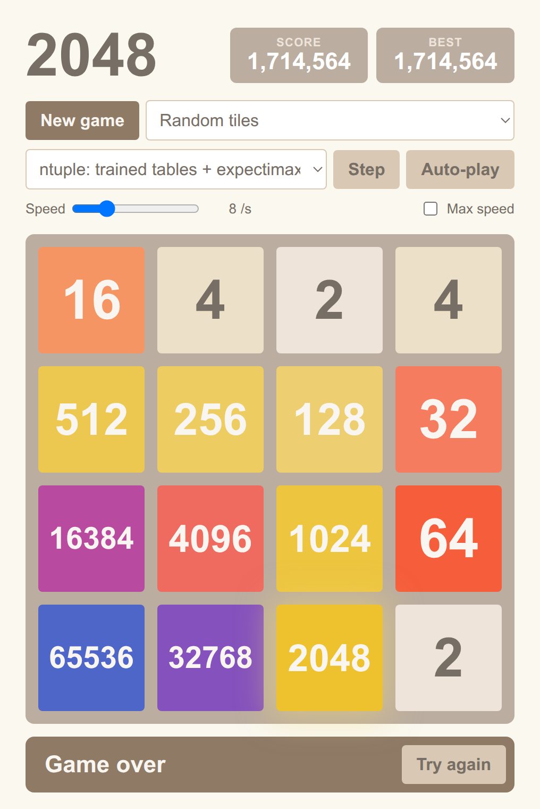
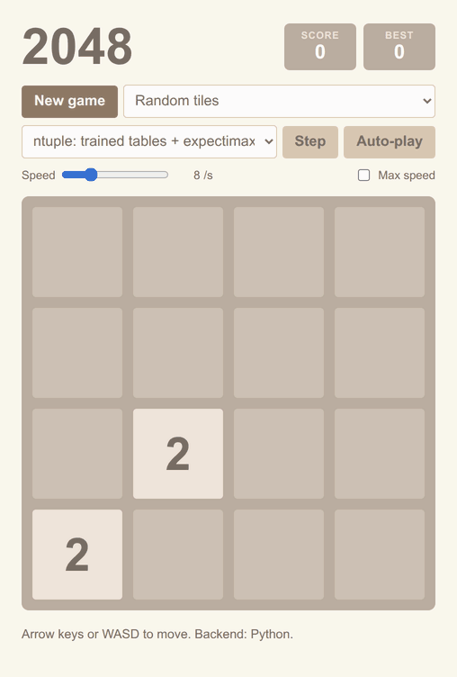
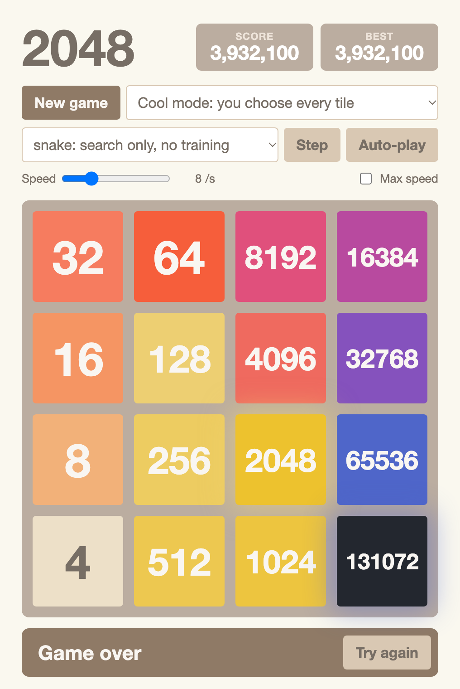
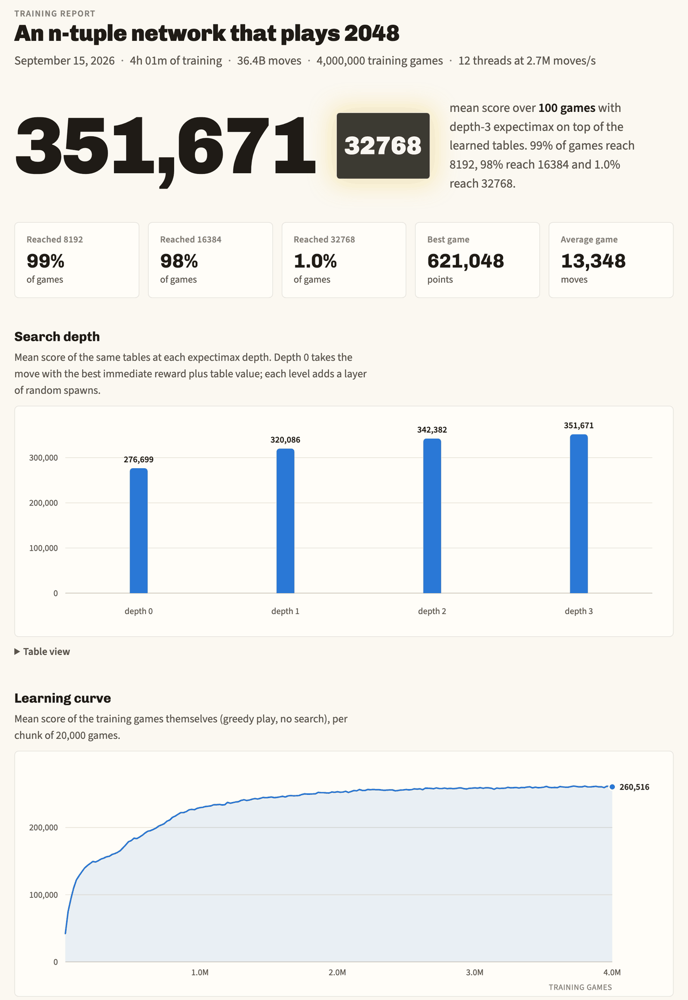

# 2048-rl

[](https://github.com/LoganBradley787/2048-rl/actions/workflows/tests.yml)

AI players for 2048, written from scratch: the game, a C engine that learns
it by playing against itself, the searches that go with it, and a web page
where you can watch them or play yourself.

Three results:

- **A record game: 1,714,564 points.** One game, played start to finish by the
  player here, ended with 65536, 32768, 16384 and 4096 on the board. The best
  single game I know of before it is macroxue's 1,704,908. The player uses
  the v2 networks below until late in the game, then a hand-written search
  and exact endgame tables. The game can be [checked and played
  again](#the-record-player-v3) move for move.
- **The normal game.** Two networks of lookup tables trained by self-play
  average **589,335 points** over 1,000 games and reach the 32768 tile in 62%
  of them. That is level with the best published player that learns the game
  (Guei, Chen and Wu, 2022) at the same search depth. They started from
  nothing, with no human games and no built-in strategy, and trained for 107
  hours on a laptop and a rented CPU machine. The
  [weights are a download](#download-the-trained-player).
- **Cool mode**, a variant where you also choose where each new tile goes. A
  search with one hand-written rule and no training builds the **131072**
  tile, the largest a 4x4 board can hold, and scores **3,932,100**, the most
  any game of 2048 can score. That bound is [checked in Lean](proof/Max2048.lean).

For scale: a person who reaches the 2048 tile once has about 20,000 points.



*The last board of the record game, game 3049, on the web page: 1,714,564
points after 55,903 moves.*



*Game 3049 from the first tile to the last: 91 moments out of 55,903 moves,
spaced closer early on, when the board changes fastest, and over the last
thousand moves, as the board fills up and the game ends.*

## Try it

You need Python 3.10 or newer, [uv](https://docs.astral.sh/uv/), and a C
compiler (`cc`), on macOS or Linux.

```bash
git clone https://github.com/LoganBradley787/2048-rl.git
cd 2048-rl
uv sync
uv run uvicorn game2048.server:app --port 8048
```

Open http://localhost:8048. Then:

1. **Play.** Arrow keys or WASD, or swipe on a phone.
2. **Watch the game in the animation above.** Set the tile mode to
   *Cool mode*, leave the player on *snake*, tick **Max speed**, and press
   **Auto-play**.
3. **Lose quickly.** Set the tile mode to *Evil tiles*, where every new tile
   lands where it hurts most.

The `snake`, `greedy` and `random` players work on a fresh clone. `ntuple`,
`ntuple-cool` and `nn` need trained weights, which are not in the repository
(the tables are 0.5 GB and up). [Train your own](#train-your-own) takes one
command, and the strongest player is a
[download](#download-the-trained-player).

Without uv, `pip install -e .` and
`python -m uvicorn game2048.server:app --port 8048` do the same thing.

## The players

| Player | What it is | Normal game, mean score | Biggest tile |
| --- | --- | --- | --- |
| `random` | random legal moves | 1,099 | 256 at best |
| `greedy` | takes the biggest merge on offer | 3,180 | 512 at best |
| `nn` | small convolutional network, 46 minutes of training in PyTorch | 29,869 | 2048 in 74% of games |
| `snake` | search with one hand-written rule, no training | 66,199 | 2048 in every game, 8192 in 12% |
| `ntuple` | lookup tables trained by self-play in C for 4 hours, plus a 3-level search | 351,671 | 16384 in 98% of games, 32768 in 1% |
| the two-stage player (v2) | two such networks, 107 hours of training, plus the same search | **589,335** | 16384 in 97% of games, 32768 in 62% |

In cool mode:

| Player | Score | Biggest tile |
| --- | --- | --- |
| `ntuple-cool`: tables trained on cool mode for 4 hours, plus a search | 1,528,428 | 65536 |
| `snake` | **3,932,100** | **131072** |

Every number comes from a run of this code. The details are under
[Results](#results).

## How it works

### Learning what a board is worth

After you move and before the new tile appears, the board is in an
*afterstate*. Each learning player holds a function V that estimates how many
more points a game will earn from a given afterstate. Playing is then simple:
try the four moves and take the one with the highest total of points from the
move plus V of the board it leaves behind.

Learning is almost as simple. Play a game by that rule, and after every move
nudge V of the previous afterstate toward the points just earned plus V of
the new afterstate. When the game ends, nudge the last one toward zero. This
is temporal-difference learning, TD(0) for short. V starts at zero
everywhere. Nobody tells the player to keep its big tile in a corner. It
finds that out from its own games.

### Lookup tables instead of a neural network

V has to be stored somehow. The `nn` player uses a small convolutional
network. The stronger choice for 2048 is plainer: an *n-tuple network*, which
is a set of lookup tables.

Pick 6 cells of the board. Their contents, 18 possibilities each (empty, 2,
4, up to 131072), form an index into a table of 18^6 = 34 million weights. V
is the sum of those lookups over 8 such patterns, each read under the 8
rotations and reflections of the board. That is 64 additions per board and
272 million weights.

Because it is only additions, it is fast, and
[`game2048/native/ntuple.c`](game2048/native/ntuple.c) is built around that.
A board is one 128-bit integer with five bits per cell. A move is four table
lookups. Training threads all write to the same tables without locks. Each
weight has its own learning rate that falls as its updates start to cancel
out (temporal coherence learning). The 8-pattern run in the table played 36
billion moves in 4 hours on 12 threads of an M3 Pro, about 2.7 million a
second, and the 4-pattern run went more than twice as fast.

Python drives the C library through `ctypes`, and the library compiles itself
with the system compiler the first time it is used.

### Looking ahead

A trained V plays well alone and better with search. *Expectimax* tries each
move, then every tile that could appear (a 2 nine times in ten, a 4
otherwise, in each empty cell), then each reply, three levels deep, with V at
the leaves. It averages over the tiles instead of assuming the worst. That
takes the 8-pattern network from 276,699 points with no search to 351,671, at
about 8 ms per move.

### The two-stage player

The strongest player here follows the recipe of Guei, Chen and Wu (2022),
with three changes to the plain method above.

- **An optimistic start.** Every board begins with a value far above any real
  score, so the player keeps trying whatever it has not yet been disappointed
  by. Starting from zero, it settles early on lines that never reach 32768.
- **Two networks.** One plays until the first 16384 appears and the other
  plays from there. The second trains only on games that begin from a million
  boards saved at that moment, so every one of its games is practice at the
  hard part.
- **Two phases.** Each network learns at a fixed rate for nine tenths of its
  games, then with temporal coherence for the last tenth, which takes the
  noise out of the tables.

When it plays, the search also uses *tile downgrading* once the board holds a
32768: it finds the largest tile value missing from the board, halves every
tile above it, and chooses its move on that smaller, more familiar board. The
two boards allow exactly the same merges.

### The late game

Once the board holds a 32768 and a 16384, the networks hand over, because
they have seen too few such boards to tell good ones from bad. Two things
replace them.

- **Endgame tables for a block of large tiles.** Strong play keeps the
  largest tiles packed in a corner and builds the next one beside them. For
  two shapes of block (two rows of three in the corner, and three along the
  edge with two below), `examples/build_endgame.py --block` solves exactly,
  for every arrangement of the small tiles around the block, the chance of
  building the next tile and the move that gives the best chance. The largest
  tables hold 21.8 billion positions at one byte each. When the board matches
  a table in any of its eight orientations, the player plays the table's
  move. That covers about 70% of the late moves.
- **A hand-written search** for every other board, four moves deep. It scores
  a board by how steadily the tiles fall away from one corner along rows and
  columns, with a heavy penalty for a large tile behind a smaller one. The
  scoring, the block shapes and the idea of tables for them come from
  [macroxue/2048-ai](https://github.com/macroxue/2048-ai); I wrote the code
  here from scratch.

### Cool mode

When you place the tiles yourself there is no luck left, and the game becomes
a puzzle. Every point comes from a merge, so a finished game's score is fixed
by its final board and by how many of the placed tiles were 4s (a placed 4
skips the 2+2 merge that would have paid 4 points). No final board beats one
of every tile from 131072 down to 4, which caps the score at 3,932,164.

The `snake` agent gets within 64 of that with a beam search: keep the 128
most promising lines of play, extend each by one move and one placement,
repeat 16 times, play the first 4 steps of the best line, and plan again. A
line is ranked by the points it earned plus one hand-written term that
rewards tiles laid out in descending order along a snake-shaped path, so that
each merge sets up the next. It places 2s unless only a 4 keeps the game
alive, and then as few as will do: 15 times in 131,000 moves. The tile that
fills the last cell is a 4 as well.

Those 64 points are out of reach for any player: at least 16 tiles have to
arrive as 4s, and the game has exactly 16. The proof is short, and
[`proof/Max2048.lean`](proof/Max2048.lean) has it in a form the Lean proof
assistant checks.

The learned tables are not involved. Tables trained on cool mode did worse
than no tables at all. [docs/COOL_MODE.md](docs/COOL_MODE.md) has the whole
story, including that argument.



## Results

Normal game. The baselines and the CNN played 500 games each (seeds from
999). The n-tuple networks played the same 100 games at each search depth
(seed 2024). Depth counts the layers of random tiles searched, so depth 0 is
no search. The `snake` figures in the table above are from 24 games.

| Player | Mean score | Median | Best game | Reach 2048 | Reach 16384 | Reach 32768 |
| --- | --- | --- | --- | --- | --- | --- |
| Random moves | 1,099 | | 3,124 | 0% | | |
| Greedy | 3,180 | | 8,456 | 0% | | |
| CNN | 23,392 | 23,236 | 70,536 | 57.2% | | |
| CNN, averaged over the 8 board symmetries (`nn`) | 29,869 | 30,984 | 76,532 | 73.6% | | |
| 4 patterns, 2 h of training, depth 0 | 241,803 | 270,258 | 372,332 | 99% | 61% | 0% |
| 4 patterns, depth 3 | 345,675 | 363,168 | 385,588 | 100% | 97% | 0% |
| 8 patterns, 4 h of training, depth 0 | 276,699 | 290,356 | 375,016 | 100% | 75% | 0% |
| 8 patterns, depth 2 | 342,382 | 362,248 | 528,284 | 100% | 93% | 1% |
| **8 patterns, depth 3 (`ntuple`)** | **351,671** | **365,754** | **621,048** | 100% | 98% | 1% |



*Part of the report page that `python -m game2048.report --ntuple` builds
from a training log, here for the 8-pattern run.*

[docs/TRAINING_LOG.md](docs/TRAINING_LOG.md) lists every training run behind
this repository, with its hardware, its length and what came of it.

### The two-stage player (v2)

The same 1,000 games at each setting (seed 2024), with the 95% interval on
the mean.

| Search | Mean score | Median | Best game | Reach 16384 | Reach 32768 |
| --- | --- | --- | --- | --- | --- |
| Depth 0 | 396,821 ± 10,449 | 378,574 | 732,360 | 84.7% | 28.8% |
| Depth 2 | 539,130 ± 10,435 | 620,610 | 742,192 | 96.3% | 58.6% |
| Depth 2, tile downgrading | 565,703 ± 12,209 | 620,928 | 840,052 | 96.3% | 58.6% |
| **Depth 3, tile downgrading** | **589,335 ± 12,170** | **629,086** | **840,244** | 97.6% | 62.5% |

The best published player that learns the game is Guei, Chen and Wu's
(2022). Their search counts one level more than the depth here, and with tile
downgrading they report 563,316 over 10,000 games where this table has
565,703, and 586,720 over 1,000 games where it has 589,335, with 32768 in
57.9% and 62.0% of games. So this player is level with theirs at equal
search, inside the error bars on both lines. Their best figure, 625,377 over
100 games, is at a search three levels deeper than any run here.

Alone, these networks never made a 65536. Their best games end near 840,000
points, a board holding every tile from 32768 down. Programs built on search
and exact endgame tables do get there:
[macroxue/2048-ai](https://github.com/macroxue/2048-ai) averages 711,769 at
its deepest search and reports a single game of 1,704,908. The record player
below adds that kind of late game to these networks.

The two networks took four training runs and 107 hours:
[docs/TRAINING_LOG.md](docs/TRAINING_LOG.md), runs 14 and 20 to 22.

### The record player (v3)

The v2 networks at depth 2 with tile downgrading, and [the late
game](#the-late-game) from the first board holding a 32768 and a 16384.
20,000 games (seed 6300):

| Mean score | Median | Best game | Reach 16384 | Reach 32768 | Reach 65536 |
| --- | --- | --- | --- | --- | --- |
| 574,188 ± 2,986 | 620,860 | **1,714,564** | 96.9% | 57.8% | 1.5% |

The best game is game 3049, 55,903 moves:

```
    16      4      2      4
   512    256    128     32
 16384   4096   1024     64
 65536  32768   2048      2
```

Its moves, its settings and the checksums of the tables are attached to the
[v3.0 release](https://github.com/LoganBradley787/2048-rl/releases/tag/v3.0).
`examples/rules2048.py`, which shares no code with the engine, checks the
game against the rules. `examples/verify_game.py` plays it again from its
seed with the v2 weights and the tables (about 1.5 hours to build, 42 GB).
It has been played again on an Intel laptop and an AMD server and came out
the same, move for move.

Measured over many games, about one in 100,000 should beat 1,704,908. This
one came early.

### Download the trained player

The weights are attached to the
[v2.0 release](https://github.com/LoganBradley787/2048-rl/releases/tag/v2.0),
335 MB for each network and 1.09 GB once unpacked.

```bash
mkdir -p checkpoints/v2 && cd checkpoints/v2
for f in 2048-ntuple-v2-stage1.bin.xz 2048-ntuple-v2-stage2.bin.xz SHA256SUMS; do
  curl -LO https://github.com/LoganBradley787/2048-rl/releases/download/v2.0/$f
done
xz -d *.xz && sha256sum -c --ignore-missing SHA256SUMS   # macOS: shasum -a 256 -c --ignore-missing
cd ../..
uv run python examples/stack_stages.py \
  --weights checkpoints/v2/2048-ntuple-v2-stage1.bin checkpoints/v2/2048-ntuple-v2-stage2.bin \
  --tiles 16384 --out checkpoints/v2/two_stage.bin
```

Then any line of the table can be played again. Games are numbered and
seeded, so the same command gives the same games on any machine:

```bash
uv run python examples/evaluate_games.py --weights checkpoints/v2/two_stage.bin \
  --games 1000 --seed 2024 --depth 2 --downgrade 32768 --out checkpoints/v2/d2-dg.csv
```

That one takes about a quarter of an hour on 16 threads, and depth 3 about
three hours.

## What did not work

- **The CNN.** It was the first learner and it stalled at 2048 in 74% of
  games. The tables passed it within the first minute of training.
- **Multi-stage tables.** Giving late-game boards their own tables is the
  idea behind the best published results. A 3-stage run seeded from the
  4-pattern tables scored 313,338 at depth 2, below the single-stage tables,
  and was dropped. Splitting the game once, at the first 16384, and training
  the second network from saved boards is what worked later.
- **Learning cool mode.** Tables trained for 4 hours on the choose game
  reached 65536. The search with no tables reached 131072.
- **Charging 4s their cost in the search ranking.** That game died at 65536.
  Planning with 2s first and falling back to 4s is what worked.
- **A bonus for empty cells** in the snake player's random-tile search. It
  was worse at every weight tried.

## Train your own

The trained weights are not in the repository: one set of n-tuple tables is
0.5 to 3 GB, far past what git is for. The two-stage player is a
[download](#download-the-trained-player), and the others are a command away.

```bash
uv run python -m game2048.ntuple_train --hours 0.2 --threads 8
```

That is 12 minutes. It writes `checkpoints/ntuple/weights.bin`, and the
`ntuple` player in the web UI picks it up. A short run goes a long way: after
140,000 games (ten minutes on a laptop that was busy with other jobs) the
tables averaged 201,797 points over 48 games with a 2-level search and
reached 8192 in 96% of them. The 2-hour and 4-hour runs in the table are the
same command with `--hours 2`, and with `--hours 4 --patterns 8x6`.

The `nn` player needs PyTorch and a run of its own:

```bash
uv sync --extra train
uv run python -m game2048.train --minutes 30
```

[docs/TRAINING.md](docs/TRAINING.md) covers the flags, the tables for
`ntuple-cool`, and the report page with the learning curves.

## What is in the repo

| Path | What it is |
| --- | --- |
| `game2048/core.py` | The rules. `Game` holds the board and score. No dependencies. |
| `game2048/native/ntuple.c` | The C engine: bitboards, the n-tuple network, TD learning, expectimax and beam search, multithreaded. |
| `game2048/ntuple.py` | The `ctypes` wrapper around it, and the `ntuple` and `snake` agents. |
| `game2048/ntuple_train.py` | Training command for the n-tuple network. |
| `game2048/server.py`, `static/` | FastAPI server and the browser UI (plain HTML, CSS and JS). |
| `game2048/env.py`, `game2048/vec_env.py` | `reset()` / `step()` environment, and a numpy engine for many boards at once. |
| `game2048/nn.py`, `game2048/train.py` | The CNN baseline and its trainer (PyTorch, optional). |
| `game2048/agents.py` | The player registry. Add your own with an `act(game)` method. |
| `game2048/report.py` | Builds an HTML report from a training log. |
| `examples/` | Evaluation and rollout scripts. |
| `proof/` | A Lean 4 proof that no game scores more than 3,932,100. `lake build` in that folder checks it. |
| `tests/` | The test suite. |

[docs/USAGE.md](docs/USAGE.md) has the Python API, the HTTP API, the tile
modes, and how to plug in your own agent.

## Tests

```bash
uv sync --extra dev
uv run pytest
```

About three minutes. The C code is checked against plain Python versions of
the same logic: the move rules against `core.py`, and expectimax, the cool-mode
tree and the beam search against small reference implementations in the
tests. The CNN tests are skipped unless PyTorch is installed
(`uv sync --extra dev --extra train`).

## References

- M. Szubert and W. Jaśkowski, "Temporal Difference Learning of N-Tuple
  Networks for the Game 2048", IEEE CIG 2014. Afterstate TD learning with
  n-tuple networks.
- K.-H. Yeh, I-C. Wu, C.-H. Hsueh, C.-C. Chang, C.-C. Liang and H. Chiang,
  "Multi-Stage Temporal Difference Learning for 2048-like Games", 2016. The
  6-cell patterns and the stages.
- W. Jaśkowski, "Mastering 2048 with Delayed Temporal Coherence Learning,
  Multi-Stage Weight Promotion, Redundant Encoding and Carousel Shaping",
  2017. Temporal coherence learning and weight promotion.
- H. Guei, L.-P. Chen and I-C. Wu, "Optimistic Temporal Difference Learning
  for 2048", IEEE Transactions on Games, 2022. The optimistic start, the
  two-phase schedule and tile downgrading, and the results the two-stage
  player is measured against.

## License

MIT. See [LICENSE](LICENSE).
